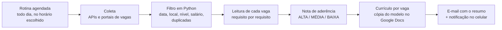

# Radar de Vagas

Um agente de IA que roda sozinho todo dia, procura vagas novas em vários portais, lê cada uma, avalia
a aderência ao seu perfil e te entrega um resumo por e-mail, com **um currículo adaptado para cada
vaga** já pronto no Google Docs.

Não é um script tradicional: é um **briefing** (um prompt longo e bem estruturado) executado por uma
rotina agendada do [Claude Code na web](https://claude.ai/code). O agente usa ferramentas como `curl`,
Python e busca web para coletar as vagas, e conectores do Gmail, Google Drive e Google Docs para
entregar o resultado.

> Este repositório traz o **modelo** do briefing, sem nenhum dado pessoal. Você preenche com o seu
> perfil e coloca para rodar.

## O que ele faz, todo dia

1. **Coleta** vagas dos últimos 7 dias em fontes com dados estruturados (Gupy, Remotar, Trampos,
   InHire, issues de repositórios de vagas no GitHub), em páginas de busca (Programathor, Nerdin,
   InfoJobs, Vagas.com.br, Catho, Empregos.com.br) e, por último, na busca web.
2. **Filtra com código** (não "de cabeça"): data de publicação, cidade ou remoto, nível, salário
   mínimo e vagas duplicadas entre fontes.
3. **Abre e lê cada vaga** que passou no filtro antes de dar a nota.
4. **Avalia a aderência** comparando requisito por requisito com o seu perfil e aponta a principal
   lacuna de cada vaga.
5. **Gera um currículo por vaga**: copia um modelo do Google Docs e troca só três marcadores
   (`{{TITULO}}`, `{{RESUMO}}` e `{{TECNOLOGIAS}}`), com uma regra de honestidade: só reorganiza e
   dá ênfase ao que é verdade, nunca inventa experiência.
6. **Entrega** o relatório por e-mail e manda uma notificação curta no celular.

Veja um exemplo fictício do resultado em [`exemplos/exemplo_de_email.md`](exemplos/exemplo_de_email.md).

## Como replicar

### O que você precisa

- Uma conta no [claude.ai](https://claude.ai) com acesso ao Claude Code na web e às rotinas
  (*routines*).
- Uma conta Google (Gmail, Drive e Docs).
- O seu currículo em um Google Docs.

### Passo a passo

**1. Prepare o modelo de currículo no Google Docs**

- Faça uma cópia do seu currículo e troque três trechos por marcadores, exatamente assim:
  - o título/cargo do topo por `{{TITULO}}`
  - o parágrafo de resumo por `{{RESUMO}}`
  - a lista de tecnologias/competências por `{{TECNOLOGIAS}}`
- Crie uma pasta no Drive para receber as cópias (ex.: "Currículos por vaga").
- Anote os **IDs** do modelo e da pasta. O ID é o trecho da URL entre `/d/` e `/edit` (documento) ou
  depois de `/folders/` (pasta).

**2. Preencha o briefing**

- Copie [`briefing_modelo.md`](briefing_modelo.md) e substitua tudo que está entre `<<` e `>>`:
  seu perfil, os cargos que procura, cidades, salário mínimo, os IDs do passo 1 e o e-mail de destino.
- Quanto mais honesto e detalhado o perfil (inclusive as **lacunas**), melhor a avaliação.
- A lista de tecnologias permitidas no currículo é a sua trava contra invenções: coloque só o que
  você realmente sabe.

**3. Crie a rotina**

1. Acesse [claude.ai/code/routines](https://claude.ai/code/routines) e crie uma rotina nova.
2. Cole o briefing preenchido como prompt.
3. Escolha o horário (ex.: todo dia às 8h). O agendamento usa cron em UTC: 8h15 em Brasília
   (UTC-3) é `15 11 * * *`.
4. No ambiente (*environment*), libere o **acesso de rede completo**. Com acesso restrito, os sites
   de vagas ficam bloqueados.
5. Adicione os conectores **Gmail**, **Google Drive** e **Google Docs**.
6. Ative as notificações push, se quiser o aviso no celular.

**4. Teste antes de confiar**

- Rode a rotina manualmente uma vez e leia o log: veja se todas as fontes foram consultadas, se o
  e-mail chegou e se os currículos ficaram corretos.
- Abra 2 ou 3 currículos gerados e confira, palavra por palavra, se nada foi inventado.

## Aprendizados (o que deu errado e como foi resolvido)

| Problema | Solução no briefing |
|---|---|
| A busca web traz muitas vagas antigas e já encerradas | Priorizar fontes com data de publicação estruturada (APIs) e usar a busca web só como complemento |
| A API antiga da Gupy passou a responder 404 | Ler o JSON embutido na página de busca do portal (`__NEXT_DATA__`) |
| Páginas da InHire carregam por JavaScript e voltam vazias | Usar a API pública com o cabeçalho `x-tenant` |
| A API do GitHub é bloqueada no ambiente das rotinas | Ler as páginas de issues pelo WebFetch |
| O agente pulava fontes quando já tinha "vagas suficientes" | Checklist obrigatório de fontes, com o resultado de cada uma no relatório |
| O agente "calculava" a idade da vaga de cabeça e errava | Filtro e marcação de vaga nova (🆕) feitos em Python |
| O agente deduzia o tipo de contrato | Regra explícita: se a vaga não diz, escrever "contrato não informado" |
| Indeed e LinkedIn bloqueiam acesso automatizado | Ficam fora da lista de fontes |
| Anexar o currículo no e-mail era caro e corrompia o arquivo | Gerar uma cópia no Google Docs e mandar só o link |

## Cuidados

- **Honestidade**: o currículo gerado só pode reorganizar fatos do seu perfil. Revise antes de enviar
  qualquer candidatura.
- **O agente não se candidata a nada**: ele pesquisa, lê e resume. A decisão e o envio são seus.
- **Conteúdo de terceiros é dado, não instrução**: o briefing manda o agente tratar o texto das
  páginas de vagas como dado, para que um anúncio não consiga dar ordens a ele.
- **Privacidade**: não publique o seu briefing preenchido. Ele tem seu e-mail, seu perfil e os IDs
  dos seus arquivos.
- Respeite os termos de uso de cada site. Não aumente a frequência além do necessário: uma vez por
  dia é suficiente.

## Licença

[MIT](LICENSE). Feito por [Mayumi Kobayashi](https://github.com/MayKobayashi).
